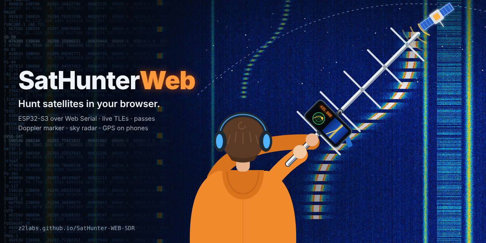

# SatHunter Web SDR

**Open it: [z2labs.github.io/SatHunter-WEB-SDR](https://z2labs.github.io/SatHunter-WEB-SDR/)** (Chrome or Edge), or download [`index.html`](index.html) and open it from disk.

The browser sibling of [SatHunterSDR](https://github.com/z2labs/SatHunter-SDR), made for classrooms: pick a satellite, see when it comes over, where to point the antenna, and its signal with the Doppler shift on the live spectrum, **with an RTL-SDR (Blog V3 / V4, listening too) or an ESP32-S3 SDR**. One HTML file, no install. It grew out of [Z2 Web SDR](https://github.com/z2labs/z2-web-sdr) and keeps all of it (16 / 40 / 80 MHz spectrum and GPU waterfall over Web Serial, firmware installer, export, debug report).

## Satellites

- **Data**: satellites, downlinks and TLEs from SatNOGS DB and CelesTrak, and how well the SatNOGS ground stations hear each downlink (SatNOGS Network). The site rebuilds `data/sats.json` every day; the page keeps a copy for offline use.
- **List**: *ESP32-S3 band* (downlinks in 2204–2804 MHz, the ones the board can receive) or *All bands* (pass planning only). Grouped as Favourites · Overhead now · Next 2 hours · Later today, or *Best heard* (most reliably received on SatNOGS first). Search by name, NORAD number or mode, star your favourites.
- **Passes** with SGP4 ([satellite.js](https://github.com/shashwatak/satellite-js)): start, end, maximum elevation, a progress bar while it is up.
- **Doppler**: the selected downlink's received frequency is a green line on the spectrum and the waterfall; with *Track* the receiver follows it.
- **Sky radar** over the spectrum: the pass track, the satellite now, the others overhead. Tap it for a bigger one, drag it anywhere.
  - On a **phone with a compass** it turns with the phone and says which way to turn ("turn left 30°, up 40°").
  - **Without a compass** (computers, phones without an absolute orientation sensor) it says so and stays north-up: the simple mode.
- **Location**: phones use the GPS, computers the browser's location (Wi-Fi / IP based) when it is allowed; or type latitude / longitude or a Maidenhead locator.
- **Simulate the next pass**: jumps the clock to just before it, and the demo source shows the satellite's signal moving with the Doppler shift, so it works in a classroom with no board and no satellite overhead.

## RTL-SDR (Blog V3 / V4 and RTL2832U sticks)

Press **RTL-SDR** in the header (Chrome or Edge, WebUSB). The page drives the stick itself (a JavaScript port of [rtl-sdr-rs](https://github.com/ccostes/rtl-sdr-rs), MPL-2.0, with the Blog V4 handling: R828D, 28.8 MHz tuner crystal, HF upconverter and band switching, bias tee for an LNA), makes the spectrum and waterfall, and **plays the audio**: NFM, WFM, AM, USB, LSB, CW at the listening point (tap the spectrum). A tracked satellite moves the listening point with its Doppler shift and picks the mode from its downlink.

- **Windows**: install the driver once with **[SatHunter-RTL-SDR-Driver.exe](https://github.com/z2labs/SatHunter-WEB-SDR/releases/download/driver-1.0/SatHunter-RTL-SDR-Driver.exe)** (one click, instead of Zadig; it is unsigned, so Windows may say *Windows protected your PC*: *More info* → *Run anyway*). Built by `.github/workflows/driver.yml` from libwdi, see `driver/`.
- **Android, ChromeOS, macOS**: nothing to install.
- **Linux**: stop the TV driver and allow the stick for your user:
  ```
  echo 'blacklist dvb_usb_rtl28xxu' | sudo tee /etc/modprobe.d/rtlsdr.conf
  echo 'SUBSYSTEM=="usb", ATTRS{idVendor}=="0bda", ATTRS{idProduct}=="2838", MODE="0666"' | sudo tee /etc/udev/rules.d/20-rtlsdr.rules
  ```
  then re-plug the stick.

## Use

1. Open the page in **Chrome or Edge** (Windows, macOS, Linux, Android). Web Serial is not available in Firefox, Safari or on iOS: there the page still plans passes and shows the radar, on demo data.
2. Allow the location when asked (or type it in).
3. Plug in an RTL-SDR and press **RTL-SDR**, or plug the ESP32-S3 in by its **native USB port** and press **Connect ESP32-S3** (the orange button installs the ESP-SDR firmware if needed).

## Build

`index.html` is generated; edit the files in `src/`.

```
python tools/build.py              # inline src/flasher.js, src/sat.js, vendor/satellite.js and the firmware
python tools/build.py --check      # CI: index.html must match the sources
python tools/fetch_data.py         # data/sats.json from SatNOGS and CelesTrak (the Pages workflow runs it daily)
```

## Tests

Headless Chromium against an emulated ESP32-S3 board, an emulated RTL-SDR (`test/mock_usb.js`) and a fixture satellite set:

```
pip install playwright && python -m playwright install chromium
python test/gen.py && node test/run.mjs && node test/md5test.mjs
node test/rtl.mjs
python test/live.py && python test/flash.py && python test/reflash.py && python test/features.py && python test/wrongport.py && python test/rack.py && python test/sats.py && python test/rtlweb.py
```

## Credits and licences

GPLv3 (see `LICENSE`). `src/rtl.js` is MPL-2.0 (a translation of rtl-sdr-rs). satellite.js is MIT (`vendor/satellite.js-LICENSE.md`). Satellite data: SatNOGS DB and Network by the Libre Space Foundation (CC BY-SA 4.0), CelesTrak. Firmware: [zodoczi/esp-sdr](https://github.com/zodoczi/esp-sdr) (fork of [ESPARGOS/esp-sdr](https://github.com/ESPARGOS/esp-sdr)), GPLv3.
